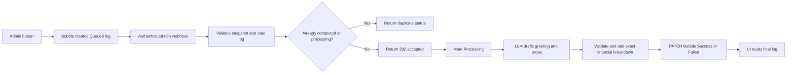

# Bubble ↔ n8n connection

## What is already built locally

`automation/bookleaf-royalty-summary.json` is a generated, inactive n8n export. Its Code node logic is tested locally with mocked n8n inputs. It has now been imported into n8n Cloud, and the saved OpenAI Header Auth credential is selected on the AI node. The Bubble development database is seeded and its author dashboard has been previewed. The webhook/Bubble credentials, connector, bulk dispatch and end-to-end execution are still unfinished; no successful live AI generation or callback is claimed.

## Chosen data flow

Bubble sends the full author snapshot from a trusted server-side workflow rather than n8n fetching Authors and Books individually. This avoids a round trip per record and avoids exposing these types through the Data API. n8n does fetch the existing NotificationLog to verify its author and status, then patches that same log. The webhook payload must come from Bubble's server-side record queries, not an arbitrary client payload.



## 1. Configure Bubble

1. Implement types, users, privacy and pages from `bubble/`.
2. Settings → API: enable the Data API and expose the NotificationLog type required by this automation. Confirm its API name is `notificationlog` and that field names match the schema. Enable field display names for API keys if your app otherwise exposes internal field IDs.
3. Confirm an authenticated GET of an existing test log returns `{ "response": { "_id": "...", "author_external_id": "AUTH001", "status": "Queued", ... } }`.
4. Confirm authenticated PATCH of `/api/1.1/obj/notificationlog/<unique-id>` can update status/content. Use the development `/version-test` prefix when working against development data; omit it for live. Do not mix environments.
5. Install Bubble's API Connector if not already present. Configure a server-side Action named GenerateRoyaltySummary: method POST, Content-Type application/json, URL copied from the activated n8n Production Webhook. Add a **Private** header `X-BookLeaf-Secret` matching the n8n credential.
6. Set a finite request timeout, surface API errors to the workflow, and treat 202 as accepted, not completed. The n8n preflight normally finishes within the 5-second GET timeout; model work happens after acknowledgement.

Example shape is in `examples/webhook-request.json`. Substitute the actual NotificationLog unique ID. Build JSON safely with Bubble's JSON-safe formatting for text fields and JSON numeric values for figures. Empty dates are null or omitted; never send "Invalid date". Send one author per request.

## 2. Start or connect n8n

Use n8n Cloud or a self-hosted instance. Docker Desktop must be running before local Compose can start.

```powershell
cd "C:\Users\DELL G7\Desktop\Shailender\Author-Project-1.2"
.\setup-local.ps1
docker compose up -d
```

Open http://localhost:5678 and finish n8n's account setup yourself. `setup-local.ps1` creates `.env` with a fresh encryption key locally; keep that file private and back up that key with the n8n data volume. It does not create a provider API key or cloud account. The initial Compose image uses n8n's stable tag; after successful import/testing record and pin the image digest/version for a reproducible submission. If using n8n Cloud, skip Compose.

The local editor listens on loopback only. Bubble's servers cannot call localhost. For self-hosting, configure an HTTPS tunnel or a hosted n8n URL, set `WEBHOOK_URL` to that public base URL, and use the webhook URL n8n displays. Keep the editor private/authenticated. Do not expose a naked unprotected port. No tunnel has been provisioned by this local package.

## 3. Import the export and bind credentials

Import `automation/bookleaf-royalty-summary.json` in n8n. Create these **Header Auth** credentials in n8n's encrypted credential store and select them on the nodes:

| Credential display name | Header | Value entered privately |
| --- | --- | --- |
| BookLeaf webhook secret | X-BookLeaf-Secret | A generated random shared secret also set as a private Bubble connector header |
| BookLeaf Bubble API | Authorization | Bearer followed by your Bubble token |
| BookLeaf LLM bearer token | Authorization | Bearer followed by your OpenAI-compatible provider key |

The workflow contains names only, not credential IDs or secret values. Import will not magically provision credentials. The default HTTP request is for an OpenAI-compatible `/v1/chat/completions` endpoint with JSON-mode support. A raw Anthropic key is not interchangeable: adapt the provider node, authentication headers, request and parser if using Anthropic's native Messages API.

Edit `config` inside **Validate & summarise**:

```js
const config = {
  llm_url: 'https://api.openai.com/v1/chat/completions',
  model: 'gpt-4o-mini',
  bubble_api_base: 'https://YOUR-APP.bubbleapps.io/version-test/api/1.1/obj',
  notification_type: 'notificationlog'
};
```

Keep callback URLs as operator configuration, never a webhook-provided URL. The default model is a starting configuration, not a claim of current availability; confirm the selected model supports your provider's JSON API. Keys stay in n8n Credentials. Do not commit them to `.env.example`, workflow JSON, screenshots or recording.

## 4. Verify before activation

Create one real Queued log in Bubble for AUTH001. Set the sample payload request_id to its unique ID and as_of to today's UTC date. Bind all credentials and use the webhook's Test URL while listening for a test event. Inspect every node input/output; then activate/publish the workflow and switch Bubble to the Production URL. Test URLs are not persistent production endpoints.

The HTTP Request node uses full responses (including statusCode), Code nodes validate exact values, and error outputs continue to a failure callback. Failure to patch Bubble after three attempts creates a failed n8n execution. Bubble must implement the stale-log timeout in `bubble/build-guide.md` so a callback outage cannot leave an endless spinner.

## Duplicate handling and concurrency

- Bubble immediately disables the button and refuses another trigger while a recent Queued/Processing log exists for that author. Bulk processing applies the same check.
- Repeated requests with the same completed log ID return duplicate=true without a new AI call. Processing returns 409.
- The supplied self-hosted Compose configuration runs production executions with concurrency=1, making the read-status/mark-Processing sequence serial on that instance.
- The Bubble Data API does not provide an atomic compare-and-set lock here. Multiple n8n instances or concurrent Cloud runs can race between read and patch. Keep Bubble-side duplicate prevention and single-worker operation for this assignment. Before enabling concurrent dispatch, add a transactional external idempotency store or a verified atomic locking design. Do not describe this export as an exactly-once concurrent delivery system.
- Reuse the same Failed notification ID on an explicit retry. Do not change credentials, app environment or author ownership of an in-flight job.

## AI output and cost

The model writes personalised prose; validated code inserts every book's exact amounts, totals, policy window and production status. This keeps a useful AI-generated email while preventing model arithmetic from changing accounting values. Prose containing digits/currency symbols is rejected to avoid unverified numeric promises. This guard does not prove every natural-language claim is correct; inspect live outputs as part of acceptance.

The payload sent to the model omits phone, email and bank information and includes only author name, titles, statuses and consolidated payout state. Prompts are capped at 500 output tokens. One AI call per eligible job, no entire company knowledge base or multi-author history. Requests time out in 20 seconds. No model failure is disguised as a successful AI summary: the log becomes Failed. The local sample text file is explicitly a deterministic fixture.

No SMTP node is configured. Status Success means summary generated and stored in Bubble. `delivery_status=Generated only` explicitly prevents a false claim of email delivery. Add email delivery only after verifying a controlled test recipient and provider setup.

## Sources checked during implementation

- Bubble Data API: https://manual.bubble.io/help-guides/integrations/api/the-bubble-api/the-data-api
- Bubble API requests: https://manual.bubble.io/core-resources/api/the-bubble-api/the-data-api/data-api-requests
- Bubble privacy rules: https://manual.bubble.io/help-guides/data/the-database/protecting-data-with-privacy-rules
- n8n Webhook: https://docs.n8n.io/integrations/builtin/core-nodes/n8n-nodes-base.webhook/
- n8n HTTP Request: https://docs.n8n.io/integrations/builtin/core-nodes/n8n-nodes-base.httprequest/
- n8n Respond to Webhook: https://docs.n8n.io/integrations/builtin/core-nodes/n8n-nodes-base.respondtowebhook/
- n8n concurrency: https://docs.n8n.io/hosting/scaling/concurrency-control/

The brief says Bubble Free is sufficient, but the current plan documentation describes live deployment/backend features on paid plans. Test your actual app's capabilities and ask the recruiter which development-preview/API arrangement they accept before purchasing anything. Documentation: https://manual.bubble.io/account-and-marketplace/account-and-billing/pricing-plans
